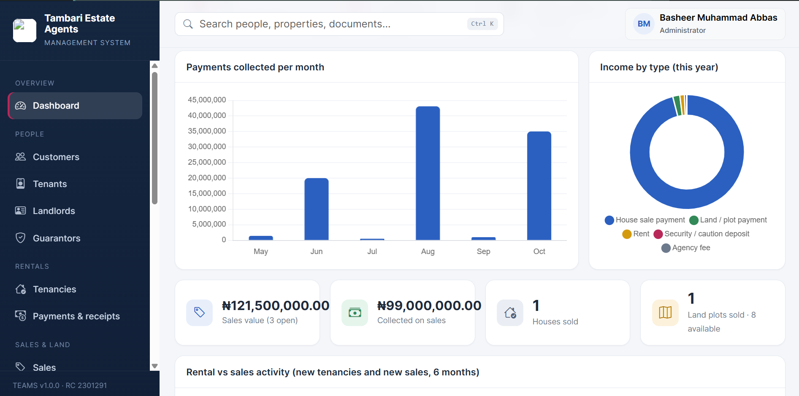
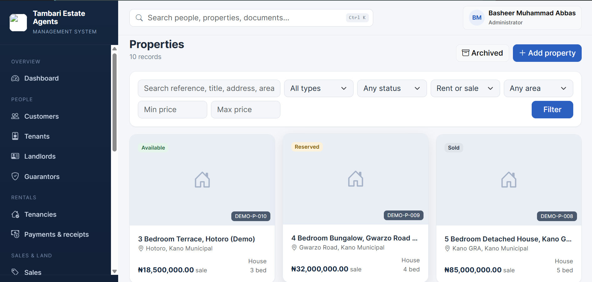
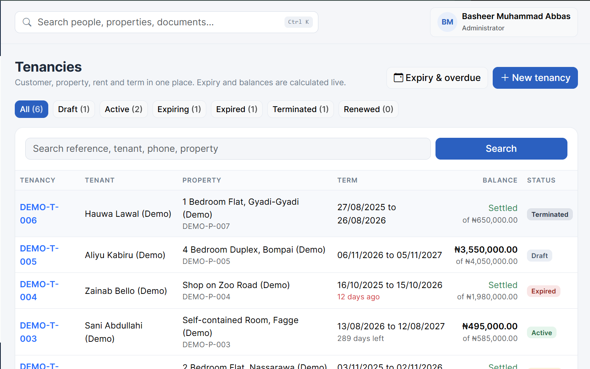
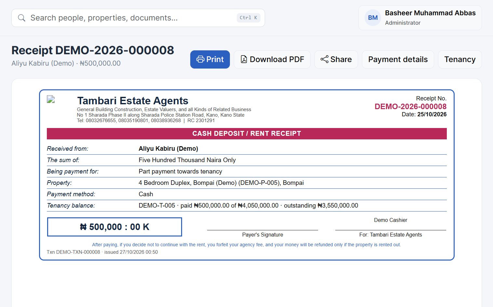
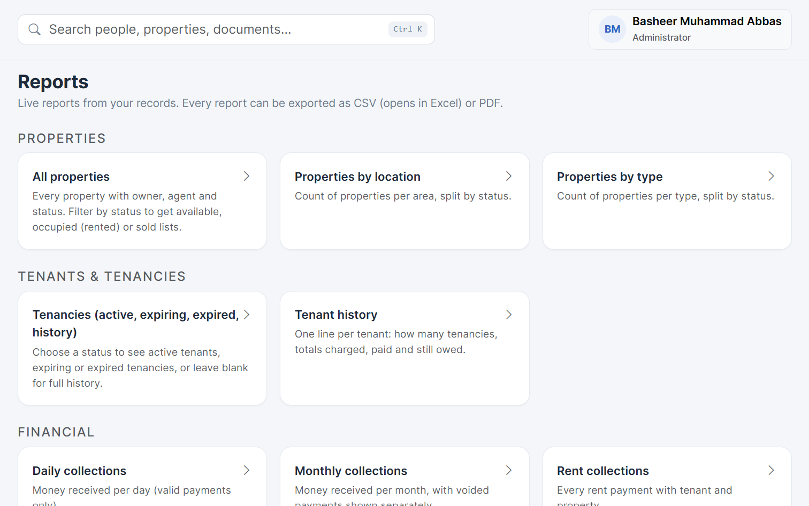

# Tambari Estate Agents Management System (TEAMS)

Version 1.0. Built with PHP, MySQL/MariaDB and Bootstrap.

## What the system does

- **People:** one customer database. A person is entered once and can be a tenant, landlord, buyer, seller and guarantor at the same time. The system warns you before creating a duplicate. Tenant, landlord and guarantor details follow your paper forms.
- **Properties:** prices and fees, features, photos, documents, and a controlled status workflow (Available, Reserved, Rented, Sold, and so on) with a history of every change.
- **Tenancies:** rent frequency (monthly, quarterly, every 6 months, yearly), deposit and fees. The server calculates the end date, total payable, instalment schedule, balance, days remaining, next payment due and overdue amount. Renew and terminate are built in.
- **Expiry and overdue tracker:** tenancies already expired and expiring within 7, 30, 60 and 90 days, and tenants who are behind on rent. This is worked out from the dates each time you open the page, so no SMS or internet is needed.
- **Payments and receipts:** every payment gets a transaction ID and a numbered receipt such as `TEA-2026-000001`, with the amount in words and the Naira/Kobo box like your paper book. Print, reprint, PDF, share from a phone, and void with a reason. Payments are never edited or deleted.
- **Tenancy agreements:** generated from an editable template based on your paper agreement, stored against the tenancy, printable and downloadable as PDF.
- **House sales:** buyer, seller, price, agreed deposit, instalment schedule, payments, balance, agent and commission, ending in a completed sale that marks the property Sold.
- **Land and plots:** estates and projects with plots (block, plot number, size, title status), a one-step "create many plots" tool, and the same sales workflow.
- **Documents:** PDF, JPG, PNG, DOC, DOCX, XLS and XLSX attached to people, properties, tenancies, sales and plots, stored privately.
- **Reports:** 20 live reports (properties, tenancies, tenant history, collections, revenue, sales, outstanding balances, staff activity and more) with filters, exportable to CSV (opens in Excel) and PDF.
- **Search** across people, properties, tenancies, payments, receipts, sales, plots and documents.
- **Dashboard** with live figures, charts and a "Needs attention" list.
- **Administration:** users, roles and permissions, audit log, settings, agreement templates, backups and demo data.

  
## Screenshots

### Dashboard


### Property Management


### Tenancy Management


### Payments &N Receipts


### Reports



## What you need

- Windows with XAMPP (PHP 8.2 or newer, Apache, MySQL/MariaDB)
- A modern browser (Chrome, Edge or Firefox)

## Installation

1. Install XAMPP.
2. Extract this ZIP into `C:\xampp\htdocs\`. You should end up with the folder `C:\xampp\htdocs\teams\`.
3. Open the XAMPP Control Panel and Start Apache and MySQL.
4. In your browser open `http://localhost/teams/`. The setup page opens by itself the first time.
5. On the setup page:
   - Check that every item in the system check is green.
   - Database: on a normal XAMPP, the defaults work (host `localhost`, user `root`, empty password). The database called `teams` is created.
   - Administrator: choose your own name, username, email and password. There is no built-in password. Use at least 8 characters with a letter and a number.
6. Click Install, then sign in.

After signing in, If you want to look around, open Settings, then Demo data, and load the sample records (you can remove them again with one click).

## Renting a property, step by step

1. Add the landlord and the tenant (Customers, Add person). Link a guarantor to the tenant if there is one.
2. Open the property and click Let this property, or go to Tenancies, New tenancy. Rent and fees come from the property and can be changed. The tenancy is saved as a **draft** and the property becomes Reserved.
3. On the tenancy page click Record payment. A receipt number is issued straight away. Print it or download the PDF.
4. Click Activate. The tenancy becomes Active and the property becomes Rented.
5. Click Agreement to generate the tenancy agreement. Print it for signing and upload the signed copy to the tenancy's Documents panel.
6. Later, use the Expiry and overdue tracker. Click Renew when a tenant continues, or Terminate when they leave.

Rules the system enforces:

- A payment cannot be larger than the outstanding balance, cannot be zero or negative, and cannot be dated in the future.
- Payments are never edited or deleted. If something was entered wrongly, void it with a reason and record it again. The original stays visible, marked VOID, and the balance is recalculated.
- Only one active or draft tenancy can exist per property. A property held by a sale cannot be let.
- Payments are applied to the oldest unpaid instalment first. Fees and the first rent payment fall due on the start date.
- A tenancy's money terms are fixed once it is active. To change them, renew.

## Selling a house or a plot, step by step

1. Add the property (listed for sale) or the plot. For land, you can first create an estate and then create all its plots at once (for example Block A, plots 1 to 40).
2. Open it and click Sell this property or Sell this plot, or go to Sales. Choose the buyer, agree the price and deposit, set the agent's commission (a percentage or a fixed amount), and optionally add an instalment schedule. Instalments must add up to exactly the price.
3. Start the sale as Negotiation (nothing is held) or Reserved (the property or plot is held for this buyer).
4. Record each payment from the sale page. The status moves by itself: Deposit paid, Partially paid, Fully paid. The first payment on a sale in Negotiation reserves the asset automatically.
5. When the balance is zero, click Complete sale and enter the completion date. The property or plot becomes **Sold** and the sale is locked.
6. To cancel a sale that has payments, first void those payments (after refunding the buyer outside the system), then cancel. The asset becomes available again.

Rules: only one open sale per property or plot, the buyer cannot be the seller, the deposit cannot exceed the price, and a sale cannot be completed unless it is fully paid.

## Receipts and agreement wording

- Receipt heading, footer text, number prefixes and the legal notice are in Settings.
- The agreement text is under Agreement templates.
- The agreement is a standard template, not legal advice.

## Reports

Open Reports, pick a report, choose any filters (dates, status, property, customer, agent, payment type) and click Run report. Use CSV / Excel or PDF to export. Totals are calculated from valid payments only (voided payments are shown separately where relevant). Each report also needs permission to the data inside it, so an Accountant sees the financial reports but not the audit report.

## Backups

Open Administration, Backups.

- **Database backup:** all records, as a standard `.sql` file. Quick and small.
- **Full backup:** the database plus every uploaded document and photo in one ZIP (needs the PHP zip extension, which is on in XAMPP by default).
- Download each backup and keep a copy on another device.
- The dashboard reminds administrators when the last backup is older than the number of days set in Settings (default 7).

To restore: open `http://localhost/phpmyadmin`, click the `teams` database, open the Import tab, choose the `.sql` file (or the `database.sql` inside a full backup ZIP) and click Import. For a full backup, also copy the `storage/documents` and `storage/images` folders from the ZIP into `C:\xampp\htdocs\teams\storage\`. These steps are also shown on the Backups page.

## Roles

An administrator can change what each role may do under Roles & permissions. Changes apply immediately.

## Folder guide

| Folder | Purpose |
| --- | --- |
| `index.php` | The single entry point of the program |
| `app/` | Program code (not reachable from a browser) |
| `views/` | Page templates (not reachable from a browser) |
| `config/` | Database settings written by the installer (not reachable from a browser) |
| `database/` | Database structure files (not reachable from a browser) |
| `storage/documents/` | Uploaded documents (private) |
| `storage/images/` | Property photos and the logo (private, served through the program) |
| `storage/backups/` | Backup files (private, downloadable only by administrators) |
| `storage/logs/` | Error logs for troubleshooting (private) |
| `storage/tmp/` | Session files and PDF font cache (private) |
| `vendor/` | The PDF library (Dompdf), included so nothing needs downloading |
| `assets/` | Styles, scripts, fonts and icons (all included, hence, offline) |
| `install/` | Setup and upgrade pages |
| `tools/` | Command-line helper for emergency password resets |

The private folders are protected by `.htaccess` files. XAMPP honours these by default. If the system is moved to another Apache server, make sure `AllowOverride All` is enabled for the folder, otherwise those protections are ignored.

## Changing a password

- Someone else's: Administrator, Users, Edit, then Reset password. The person must choose a new password at their next sign-in.
- If administrator's password is lost: open Command Prompt on the computer and type (using your real username and a new temporary password):

```
C:\xampp\php\php.exe C:\xampp\htdocs\teams\tools\reset-password.php admin NewPassword1
```

  Then sign in with that temporary password. You will be asked to choose a new one straight away. The reset is recorded in the audit log. This tool only works from the command line, never from a browser.

## Upgrading from an earlier version

1. Create a backup (Administration, Backups) and download it.
2. Extract the new ZIP over the old folder and choose Replace. Your `config/config.php` and `storage` folder are not in the ZIP, so they are kept.
3. Sign in as administrator. You are taken to the upgrade page automatically (or open `http://localhost/teams/install/upgrade.php`). Click Run upgrade.

Until the upgrade is run, other staff see a short "upgrade in progress" notice instead of the system.

## Troubleshooting

| Problem | What to do |
| --- | --- |
| "Could not reach MySQL" | Start MySQL in the XAMPP Control Panel |
| Setup says "storage/... is writable" is red | Right-click the `teams` folder, Properties, untick Read-only, apply to all items |
| Page says the system could not connect to its database | MySQL is stopped, or the password in `config/config.php` changed |
| Photo or document will not upload | Files must be under 8 MB and of an allowed type. For very large uploads raise `upload_max_filesize` and `post_max_size` in `C:\xampp\php\php.ini`, then restart Apache |
| Photos fail on upload | In `php.ini` make sure `extension=gd` and `extension=fileinfo` do not start with a semicolon |
| Full backup says the zip extension is missing | In `php.ini` remove the semicolon before `extension=zip`, then restart Apache |
| "Your form expired" | You were idle too long, or opened the form in two tabs. Refresh the page and try again |
| Account locked | Five wrong passwords lock an account for 15 minutes. An administrator can unlock it on the Users page |
| Something else | Look at the newest file in `storage/logs/`. It records technical details that are hidden from normal users |

## Security notes

- Passwords are stored as one-way hashes. Nobody, including administrators, can read them.
- Every form is protected against cross-site request forgery. All database access uses prepared statements. All output is escaped.
- Uploaded files are checked by real content type, renamed to random names and kept outside direct web access. Downloads go through the program, which checks permissions and records the download.
- If other people on your network can reach this computer, set a password for MySQL's `root` user in XAMPP and update `config/config.php` to match. Do not expose the system to the internet without HTTPS.

## Unimplemented features/functionalities

- Refunds are not a separate feature. To correct a payment, void it and record the right one. Cancelling a sale that has payments needs those payments voided first.
- Overdue rent and overdue sale installments are worked out from their schedules. The system does not add late fees or interest.
- Commission is recorded as an agreed figure per sale and reported by agent. Paying commission out is not tracked.
- Printing uses the browser's print dialog, so page size and margins follow the printer settings. The PDF is always A5 for receipts, A4 for agreements and A4 landscape for reports.
- Backups are stored on the same computer until it is downloaded. There is no automatic cloud copy and no scheduled backup.
- Notifications by SMS, WhatsApp or email, online payments, a tenant portal and a public listings website are not yet implemented.
- The system was tested on Linux with PHP 8.3, MariaDB 10.11 and Apache 2.4 using the same `.htaccess` rules, including real-browser checks at phone and desktop widths.
